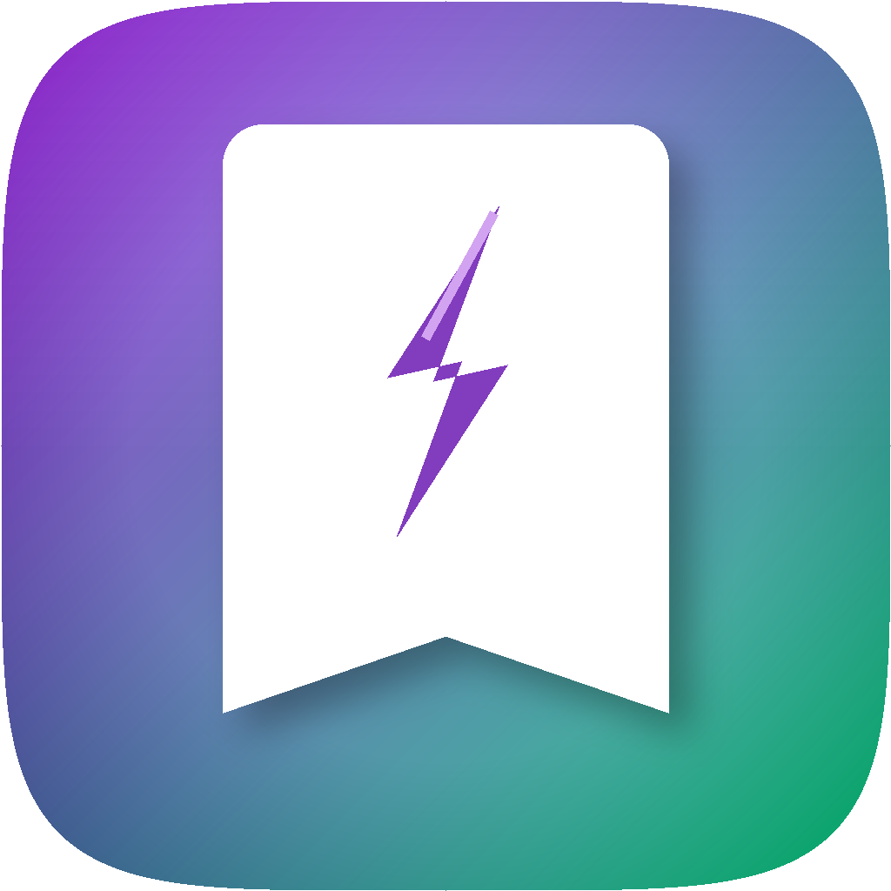

<p align="center">
  
</p>

<h1 align="center">SpeedyLauncher</h1>

<p align="center"><em>A keystroke between you and any app, folder or shortcut.</em></p>

<p align="center">
  <a href="https://apps.apple.com/app/speedlauncher/id6757640569">Download on the App Store</a>
  ·
  <a href="https://n14395.com/speedlauncher">Website</a>
</p>

SpeedyLauncher is a lightweight macOS menu bar utility for launching your most-used
applications, Apple Shortcuts, and folders. Press a global hotkey (default:
**⌘⇧Space**), tap a number key, and you're there — no Dock icon, no Finder
digging, no interruption to your workflow.

<p align="center">
  
</p>

## Features

- **Global hotkey** — open the launcher from anywhere with a fully customizable
  system-wide shortcut
- **Keyboard-first** — every item gets a number key (1–9, 0); expand a category
  and the numbers reassign to its children, so you never touch the mouse
- **Four action types** — launch applications, open folders in Finder, run
  Apple Shortcuts, or group items into collapsible **categories**
- **Apple Shortcuts integration** — trigger any shortcut directly; pair it with
  Shortcuts that run shell scripts or AppleScript for power-user workflows
- **Custom icons** — pick from ~1,500 SF Symbols, or keep the app/folder's own icon
- **Drag-and-drop reordering** and collapsible categories to keep things tidy
- **Import/export configuration** to move your setup between Macs
- **Launch at login**, customizable menu bar icon, native SwiftUI throughout

## Screenshots

| Managing actions | General settings |
|---|---|
|  |  |

Adding an item is a small form: choose the type, point it at an app, folder, or
shortcut, and optionally give it a name and SF Symbol icon:

<p align="center">
  
</p>

## Privacy

Everything is stored locally. SpeedyLauncher makes zero network requests, has no
analytics, and collects no data. Your configuration lives in a single JSON file at
`~/Library/Application Support/SpeedyLauncher/config.json`.

## Requirements

- macOS 14.0 (Sonoma) or later

## Install

```sh
brew tap n14395/tap
brew install --cask speedy-launcher
```

Or download the `.dmg` from [Releases](../../releases) and drag SpeedyLauncher to
Applications.

## Building from source

The project is a standard Xcode project (`SpeedyLauncher.xcodeproj`). Open it in
Xcode and run, or use the build script:

```sh
./build.sh                 # build the release app into build/SpeedyLauncher.app
./build.sh --dmg           # …and package it into build/SpeedyLauncher.dmg
./build.sh --sign          # …Developer ID sign, notarize and staple
./build.sh --publish vN.N  # tag, push and cut a GitHub release from the .dmg
```

Building requires full Xcode (not just the Command Line Tools).

## Project layout

```
SpeedyLauncher/
├── SpeedyLauncherApp.swift      # @main entry point
├── AppDelegate.swift            # Menu bar & popover management
├── Models/                      # ActionItem, AppSettings
├── Services/                    # StorageService, ActionExecutor, HotkeyManager
└── Views/                       # Popover, rows, SF Symbol picker, Settings
```

A few implementation notes:

- The global hotkey is registered through the Carbon `RegisterEventHotKey` API.
- The app is sandboxed: folders are accessed via security-scoped bookmarks and
  Shortcuts run through the `shortcuts://` URL scheme.
- `StorageService` is `@MainActor` for UI-bound state; `ActionExecutor` is an
  `actor` so action execution stays thread-safe.
- `LSUIElement` keeps the app out of the Dock — it lives entirely in the menu bar.

---

<p align="center">© 2026 n14395 · <a href="https://n14395.com/speedlauncher">n14395.com/speedlauncher</a></p>

## License

Licensed under the [Apache License, Version 2.0](LICENSE).
Third-party attribution is in [NOTICE](NOTICE).
